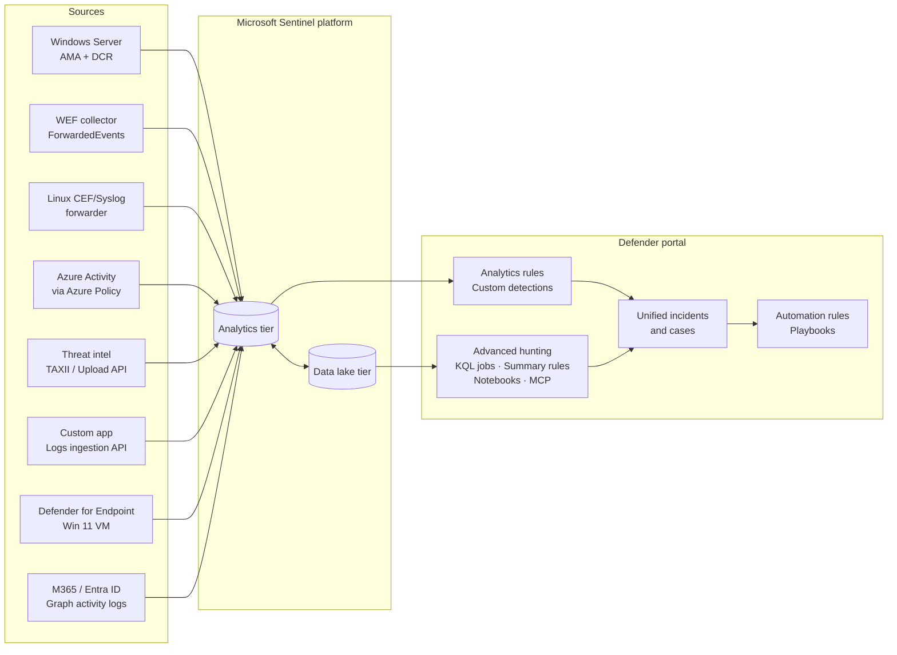

# Unified SecOps Lab — Microsoft Sentinel + Defender XDR (SC-200)


A hands-on security operations lab that builds the **full Microsoft unified SecOps platform end to end**: data ingestion into Microsoft Sentinel and its data lake, detections in Sentinel and Defender XDR, endpoint hardening and response with Defender for Endpoint, Microsoft 365 investigations, and advanced hunting.

Every module produces **real, reusable artifacts** (KQL, data collection rules, rule YAML, scripts, playbooks) plus evidence screenshots and a write-up of what worked, what broke and how I fixed it.

> **Scenario:** *ValleyCrest Behavioral Health Network (VCBHN)*, a fictional HIPAA-regulated healthcare organization. All data, tenants, users and IPs in this repo are lab-generated. No production or employer data is used.

---

## Architecture



---

## Modules

| # | Module | What it proves | Status |
|---|---|---|---|
| 01 | [Data ingestion & platform](modules/01-ingestion-platform) | AMA + DCRs, WEF, CEF/Syslog forwarder, Azure Policy, threat intel, custom tables, retention tiers, data lake, SOC optimization, RBAC | ⬜ Not started |
| 02 | [Detections & automation](modules/02-detections-automation) | Scheduled + NRT rules, XDR custom detections, anomalies, MITRE coverage, automation rules, playbooks | ⬜ Not started |
| 03 | [Defender for Endpoint hardening](modules/03-mde-hardening) | ASR rules (audit → block), indicators, device groups & automation levels, custom data collection, XDR settings | ⬜ Not started |
| 04 | [Endpoint response & case management](modules/04-endpoint-response) | Device timeline, live response, investigation package, attack disruption, incident cases | ⬜ Not started |
| 05 | [Microsoft 365 investigation (BEC)](modules/05-m365-investigation) | Threat Explorer, Purview Audit (MailItemsAccessed), Content search, Graph activity logs, identity remediation | ⬜ Not started |
| 06 | [Advanced hunting](modules/06-advanced-hunting) | KQL hunting pack, threat analytics, hunting graph, KQL jobs, summary rules, notebooks, Sentinel MCP server | ⬜ Not started |

Status key: ⬜ Not started · 🟡 In progress · ✅ Complete (with evidence)

---

## Skills demonstrated (mapped to SC-200)

| SC-200 domain | Weight | Covered in |
|---|---|---|
| Manage a security operations environment | 40–45% | Modules 01, 02, 03 |
| Respond to security incidents | 35–40% | Modules 04, 05 |
| Perform threat hunting | 20–25% | Module 06 |

## Detection coverage (MITRE ATT&CK)

| Tactic | Technique | Detection | Platform |
|---|---|---|---|
| Credential Access | T1110.001 Password Guessing | [Windows brute force](modules/02-detections-automation/rules/windows-brute-force.yaml) | Sentinel (Scheduled) |
| Credential Access | T1110.003 Password Spraying | [Entra password spray](modules/02-detections-automation/rules/entra-password-spray.yaml) | Sentinel (Scheduled) |
| Privilege Escalation | T1098.003 Additional Cloud Roles | [Privileged role assigned](modules/02-detections-automation/rules/entra-privileged-role-assigned-nrt.yaml) | Sentinel (NRT) |
| Persistence | T1098.003 / T1528 | [Consent to application](modules/02-detections-automation/rules/entra-app-consent-granted.yaml) | Sentinel (Scheduled) |
| Collection | T1114.003 Email Forwarding Rule | [Inbox forwarding rule](modules/02-detections-automation/rules/m365-inbox-forwarding-rule.yaml) | Sentinel (Scheduled) |
| Credential Access | T1558.003 Kerberoasting | [Kerberoasting (RC4)](modules/02-detections-automation/rules/windows-kerberoasting.yaml) | Sentinel (Scheduled) |
| Command and Control | T1071 | [Connection to TI IP](modules/02-detections-automation/rules/ti-ip-match-network.yaml) | Sentinel (Scheduled) |
| Execution | T1059.001 PowerShell | [Encoded PowerShell](modules/02-detections-automation/custom-detections/encoded-powershell.kql) | Defender XDR custom detection |
| Defense Evasion | T1070.001 Clear Windows Event Logs | [Security log cleared](modules/02-detections-automation/rules/windows-security-log-cleared-nrt.yaml) | Sentinel (NRT) |

All rule files are validated on every push by a [GitHub Actions workflow](.github/workflows/validate-detections.yml).

---

## Repository layout

```
unified-secops-lab/
├── README.md
├── docs/
│   ├── lab-setup.md            # Lab 0: tenant, workspace, VMs, cost controls
│   ├── cost-guide.md
│   └── lessons-learned.md      # running log of what broke and how I fixed it
├── modules/
│   ├── 01-ingestion-platform/
│   ├── 02-detections-automation/
│   ├── 03-mde-hardening/
│   ├── 04-endpoint-response/
│   ├── 05-m365-investigation/
│   └── 06-advanced-hunting/
├── templates/
│   ├── detection-writeup.md
│   └── module-evidence-checklist.md
├── tools/validate_rules.py
└── .github/workflows/validate-detections.yml
```

## How to reproduce

1. Follow [docs/lab-setup.md](docs/lab-setup.md) to build the lab (Microsoft 365 E5 trial, Azure subscription, Sentinel onboarded to the Defender portal and data lake, one Windows 11 VM onboarded to MDE).
2. Work through the modules in order. Each module README has **steps**, **"done when"** checks and an **evidence list**.
3. Keep costs low with the controls in [docs/cost-guide.md](docs/cost-guide.md).

## About me

**Leon Kiyonga** · Security Operations / Detection Engineering · Sacramento, CA
[LinkedIn](https://www.linkedin.com/in/leon-kiyonga-ddungu) · [All projects](https://github.com/mataleon)

*This lab is for education and portfolio purposes. Lab data is synthetic.*
