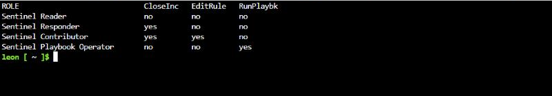

# RBAC test matrix

**Setup (2026-11-13):** three test users, each granted one Microsoft Sentinel role on `rg-secops-lab`. Microsoft recommends assigning Sentinel roles at the resource group level. Because the tenant has Entra ID P2, the Azure role wizard first created the assignments as **PIM-eligible (time-bound)**. For testing they were then converted to **Active (permanent)**.

| Test user | Role | Assignment |
|---|---|---|
| `soc.reader` | Microsoft Sentinel Reader | Active (was PIM eligible) |
| `soc.responder` | Microsoft Sentinel Responder | Active (was PIM eligible) |
| `soc.engineer` | Microsoft Sentinel Contributor | Active (was PIM eligible) |

## Expected permissions (Microsoft docs) vs. tested

✓ = allowed, ✗ = blocked. "Expected" comes from [Roles and permissions in the Microsoft Sentinel platform](https://learn.microsoft.com/azure/sentinel/roles). Fill in "Tested" after signing in as each user and activating the role.

| Action | Sentinel Reader | Sentinel Responder | Sentinel Contributor | + Playbook Operator |
|---|---|---|---|---|
| View incidents | ✓ | ✓ | ✓ | ✗ |
| Assign / close incident | ✗ | ✓ | ✓ | ✗ |
| Create / edit analytics rule | ✗ | ✗ | ✓ | ✗ |
| Create workbook | ✗ * | ✗ * | ✓ * | ✗ |
| Install Content hub solutions | ✗ | ✗ | ✓ | ✗ |
| Run playbook on incident | ✗ | ✗ | ✗ | ✓ |
| Edit playbook | ✗ | ✗ | ✗ | ✗ (needs Logic App Contributor) |

\* Creating or deleting workbooks also needs the **Workbook Contributor** role.

### Verified against the role definitions

Checked on 2026-11-21 in Cloud Shell. Each built-in role's `actions` list was matched against the Azure operation behind each task: `SecurityInsights/incidents/write` (close incident), `SecurityInsights/alertRules/write` (edit analytics rule) and `Logic/workflows/triggers/listCallbackUrl/action` (run playbook).

| Role | Close incident | Edit analytics rule | Run playbook |
|---|---|---|---|
| Sentinel Reader | ✗ | ✗ | ✗ |
| Sentinel Responder | ✓ | ✗ | ✗ |
| Sentinel Contributor | ✓ | ✓ | ✗ |
| Sentinel Playbook Operator | ✗ | ✗ | ✓ |

The results match Microsoft's documented matrix above, including the classic exam trap: **Contributor can't run playbooks.**

### Hands-on test in the Defender portal (2026-11-21)

Each user signed in fresh in a private window and tried the actions on incident #2 (raised by my brute-force rule) and on that rule itself.

| Test user | Close / reopen incident #2 | Edit analytics rule | Evidence |
|---|---|---|---|
| `soc.reader` | ✗ "Limited access: read-only" banner, edit pencil greyed | ✗ Edit, Create, Enable, Disable, Delete greyed | [incident](evidence/lab11-reader-incident-readonly.png) · [rule](evidence/lab11-reader-rule-edit-blocked.png) |
| `soc.responder` | ✓ reopened #2 (Closed → Open) | ✗ Edit and toolbar greyed | [incident](evidence/lab11-responder-reopened-incident.png) · [rule](evidence/lab11-responder-rule-edit-blocked.png) |
| `soc.engineer` | ✓ closed #2 (Benign Positive) | ✓ edit wizard opened | [incident](evidence/lab11-engineer-closed-incident.png) · [rule](evidence/lab11-engineer-rule-edit-wizard.png) |

All three results match the documented permissions.

## Findings

- **No role can run playbooks, not even Contributor.** That needs **Microsoft Sentinel Playbook Operator** (run) or **Logic App Contributor** (run and edit). Sentinel itself also needs **Microsoft Sentinel Automation Contributor** on the playbook's resource group before automation rules can call a playbook.
- **The P2 tenant defaulted to PIM-eligible assignments.** `az role assignment list` shows nothing for an eligible user until they activate the role, so I first thought the assignments had failed. Activation also needs a **fresh sign-in**: a browser session opened before activation keeps the old token, and the portal still blocks the action.
- **Stale session after a role change.** soc.engineer was first blocked from editing even with Contributor active. The browser session had been opened before the role change. Signing out and back in fixed it.
- **Portal quirk.** For soc.engineer, the **Edit** button in the rule's side panel stayed greyed out, but **⋯ → Edit** on the rule row opened the wizard. If an action looks blocked, check the toolbar (Create/Enable/Delete) to see what the role really allows.
- **Default filters hide closed or low-priority incidents.** The new Cases view starts with a "Priority score 15–100" filter, so incident #2 seemed to be missing until I removed it.
- **Role assignments are cumulative.** A Reader who is also a Contributor gets Contributor rights, so audit for stacked roles.

**Takeaway:** a SOC analyst needs **Responder** to work incidents and **Playbook Operator** to run response actions. **Contributor** is for detection engineers who change rules and content. All three should be PIM-eligible, not permanent.
