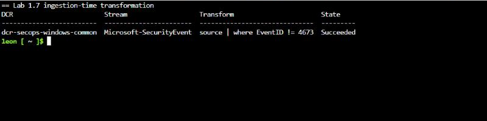
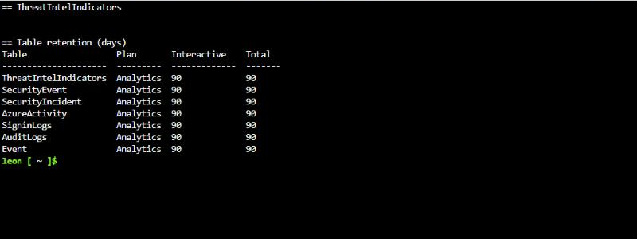

# Retention, tier and noise decisions (Lab 1.7)

## 1. Noise: drop event 4673 at ingestion

**What I saw.** After connecting `vm-win-01`, event **4673 (a privileged service was called)** made up about **915 of roughly 1,300 `SecurityEvent` rows in 3 hours**. That's more than every other event ID combined. It's routine OS behaviour with almost no detection value on its own.

**What I did.** I added an **ingestion-time transformation** to the connector-created DCR `dcr-secops-windows-common`:

```kql
source | where EventID != 4673
```



**Why a transformation instead of editing the XPath.** The Common event set is managed by the Windows Security Events connector, and editing its XPath list by hand would be overwritten if the connector is reconfigured. A `transformKql` filter is kept as part of the DCR, can be audited, and is the method the SC-200 exam expects for "filter or modify data before it's stored."

**Cost reality check.** Total `SecurityEvent` volume over 3 days was about **0.004 GB**, which is pennies and is covered by the Sentinel free trial anyway. In this lab the change improves **signal-to-noise**, not the bill. At production scale (hundreds of servers) the same 70% cut would matter for cost too.

## 2. Overlapping DCRs

Both `dcr-secops-windows-common` (connector, *Common* set) and `dcr-secops-windows-security-custom` (my XPath DCR) collect 4624/4625, so those events are stored twice. **Decision:** keep both for this lab, so the duplication can be demonstrated, and document it. In production I'd keep **one DCR per event set**: either the connector's *Common* set with transformations, or a custom XPath DCR alone.

## 3. Table retention

Current settings, all on the Analytics plan, with 90 days interactive retention that is free with Sentinel:



| Table | Plan | Interactive | Total | Decision for this lab | Production recommendation |
|---|---|---|---|---|---|
| SecurityEvent | Analytics | 90 d | 90 d | Keep the default (free) | 90–180 d analytics, 1–2 years total for investigations |
| SigninLogs | Analytics | 90 d | 90 d | Keep the default | 90 d analytics (identity detections), 1–2 years total |
| AuditLogs | Analytics | 90 d | 90 d | Keep the default | 90 d analytics, 1 year total (admin changes) |
| AzureActivity | Analytics | 90 d | 90 d | Keep the default (Azure Activity ingestion is free) | 90 d analytics, 1 year total |
| ThreatIntelIndicators | Analytics | 90 d | 90 d | Keep the default | Match the indicator validity period |
| CommonSecurityLog (future) | — | — | — | Not connected yet (Lab 1.3) | **Data lake tier**: high volume, low real-time value; query with KQL jobs and summary rules |

**Why no long-term retention here:** anything beyond the free 90 days is billed per GB per month, and this lab runs on a $25/month budget. The production column records the decision I'd make with a real budget and compliance requirements.

## 4. Data lake

The Sentinel data lake isn't onboarded in this tenant yet. The option hadn't appeared in the Defender portal, and onboarding can't be undone without a support ticket. Moving high-volume tables to the lake tier is planned for Module 06.
