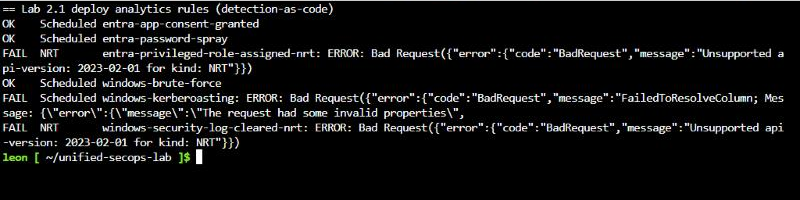

# Module 02 — Detections & automation

**SC-200 objectives:** Configure detections · Configure automation for Defender XDR and Microsoft Sentinel
**Time:** 3–4 evenings · **Prereq:** Module 01 data flowing

## Lab 2.1 — Deploy the analytics rules in [rules/](rules/)

Rules are stored as YAML (Sentinel content format) and checked by CI. Create each one in Sentinel → Analytics → **Create scheduled rule** / **NRT rule**, copying the query, schedule, entity mapping and custom details.

For every rule:
1. Emulate the activity (see each rule's description).
2. Confirm an incident fires.
3. Fill in a write-up from [templates/detection-writeup.md](../../templates/detection-writeup.md) in `writeups/`.

Settings to practice on at least one rule each: **event grouping per result**, **suppression**, **alert grouping by entity**, **alert details override**, **custom details**.

## Lab 2.2 — Defender XDR custom detections

Run each query in [custom-detections/](custom-detections/) in Advanced hunting → **Create detection rule** → frequency **every hour** → action as noted in the file. Emulate with an encoded PowerShell `Write-Output` command on `win11-ep-01`.

## Lab 2.3 — Anomalies and UEBA
1. Settings → **Entity behavior analytics** → enable with SigninLogs, AuditLogs, AzureActivity, SecurityEvent.
2. Analytics → **Anomalies**: duplicate one anomaly rule, change its threshold, set the copy to **Flighting**.
3. After a few days, compare: `Anomalies | summarize count() by AnomalyTemplateName, RuleStatus`.

## Lab 2.4 — MITRE ATT&CK coverage
Sentinel → **MITRE ATT&CK** page → screenshot Active vs Simulated coverage before and after deploying the rules.

## Lab 2.5 — Automation rules and playbook
Follow [automation/automation-rules.md](automation/automation-rules.md) and [playbooks/README.md](playbooks/README.md).

## Results so far (2026-11-21)

Rules and automation are deployed from this repo with [tools/deploy_rules.py](../../tools/deploy_rules.py) and [tools/deploy_automation_rules.py](../../tools/deploy_automation_rules.py). Re-running either script updates rules in place.

| Item | Status | Evidence |
|---|---|---|
| 6 analytics rules deployed (4 scheduled, 2 NRT) | ✅ | [deploy output](evidence/lab21-deploy-rules-as-code.png) |
| Windows brute force | ✅ Fired: incident #2 (10 runas failures) | see Module 01 |
| Security log cleared (NRT) | ✅ Fired: **incident #4 (High)**. Log cleared on `vm-win-01` via Run Command. **Defender for Endpoint fired first** with multi-stage incident #3 (attempt to clear event log / event log cleared / suspicious activity through Azure VM extension). 1102 arrived twice because of the overlapping DCRs from Module 01 | [incident #3](evidence/lab21-mde-log-clear-incident3.png) · [incident #4](evidence/lab21-log-cleared-nrt-incident4.png) |
| Privileged Entra role assigned (NRT) | ✅ Fired: **incident #5 (High)** about 10 min after Security Administrator was assigned to `soc.engineer` (the PIM-backed assignment logs 3 audit events) | [incident #5](evidence/lab21-privileged-role-incident5.png) · [role assigned](evidence/lab21-trigger-security-admin-assigned.png) |
| Consent granted to an application | ⏳ Waiting for the trigger | — |
| Entra password spray | Deployed; needs 10+ accounts from one IP to fire | — |
| Kerberoasting | Deployed; needs a domain controller (4769) | — |
| TI IP match, M365 inbox forwarding | Not deployed: CommonSecurityLog / OfficeActivity not connected yet | — |
| Automation rules AR01–AR03 | ✅ AR01 suppression **expires after 30 days**. AR03 verified: it added its 3 triage tasks to High incidents #4 and #5. AR02 verified: it assigned #5 to `soc.responder` and tagged it `identity` | [rules](evidence/lab25-automation-rules.png) · [tasks on #4](evidence/lab25-ar03-tasks-on-incident4.png) · [AR02+AR03 on #5](evidence/lab25-ar02-ar03-on-incident5.png) |
| AR04 + notify playbook | Not started | — |

### What broke on the first deploy (and the fixes)

1. **NRT rules were rejected by the GA API** ("Unsupported api-version … for kind: NRT"). The deploy script now sends NRT rules through `2024-10-01-preview`.
2. **Kerberoasting referenced a column that doesn't exist.** `SecurityEvent` has no `TicketEncryptionType` column, so the query now extracts it from `EventData`. The YAML validator in CI checks structure, not schema, so only a real deployment caught this. That's a good argument for deploying to a test workspace in CI.
3. **XDR caught the log clear before the SIEM.** The 1102 event took longer to reach `SecurityEvent` after the VM booted than Defender for Endpoint took to raise its own incident.

## Done when
- [ ] 8 analytics rules deployed (6 scheduled, 2 NRT), each with a write-up
- [ ] 2 XDR custom detections deployed and triggered once
- [ ] Anomaly rule duplicated into Flighting
- [ ] MITRE coverage screenshots (before/after)
- [ ] Automation rules + playbook working end to end
